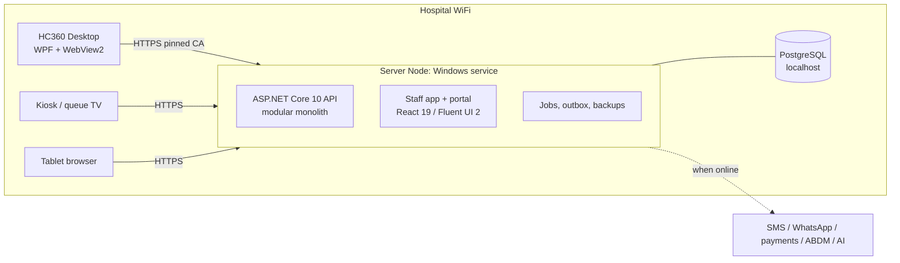

# HyFib HealthCare360

**A complete hospital information system for Nana Hospitals, delivered as a Windows application.** A dedicated
Windows machine on the hospital WiFi runs the HC360 server. Doctors, nurses, front desk, billing, pharmacy, lab and
administration use **HC360 Desktop** on workstations, and patients use the **patient portal**.

| Area | Modules |
|---|---|
| Core clinical | EHR / EMR physician desktop, e-prescribing with drug-safety checks, telehealth video consultations, remote patient monitoring, medical imaging (PACS), laboratory (LIS), radiology, cardiology |
| Patient services | Front office and registration (UHID), online doctor appointments, queue and display boards, patient portal, health check-ups, feedback, CRM |
| In-patient | Ward and bed management, admissions and discharge, nursing charts and MAR, operation theatre, dialysis, physiotherapy, blood bank, dietary |
| Pharmacy and stores | OP and IP pharmacy, inventory, purchase and GRN, CSSD, asset management |
| Finance | OP and IP billing (GST), insurance and TPA, doctor fee accounting, Tally export |
| Management | HRMS, incident reporting and risk management (IRMS), medical records and ICD coding, MIS reports, managed BI, AI voice assistant |
| Integrations | SMS, WhatsApp, payment gateway, POS, Tally, barcode, ICD, biometric attendance, PACS, laboratory analysers |

## How it fits together



- **Server**: .NET 10 and ASP.NET Core minimal APIs; one project per module (bounded context); EF Core 10 on
  PostgreSQL; SignalR for live updates; Quartz jobs; a transactional outbox.
- **Web**: React 19, TypeScript 6, Vite 8, Fluent UI 2, TanStack Router and Query, React Hook Form with Zod.
- **Desktop**: WPF with WebView2. It finds the server over mDNS and pins the hospital CA. A JSON-RPC bridge gives the web
  app silent printing, raw label printing, WiFi status, notifications and dictation.
- **WiFi resilience**:
  - Every write carries an idempotency key, so retries never duplicate data.
  - Forms save drafts locally.
  - Screens show a connection banner and reconnect on their own.
  - The server monitors its own WiFi link.

See `docs/architecture/ARCHITECTURE.md` and `docs/architecture/DECISIONS.md`.

## Repository layout

```
src/server/                 HC360 server: Platform, SharedKernel, Integrations, Server host, Modules/*
src/web/                    pnpm workspace: apps/staff, apps/portal, packages/core, packages/ui
src/desktop/                HC360 Desktop (WPF + WebView2)
src/shared/                 Windows interop (Native WiFi)
tests/                      xUnit v3 test projects (one per module), desktop tests
deploy/windows/             Install / upgrade / restore / publish scripts
deploy/docker/              Development database (PostgreSQL) and optional Orthanc PACS
docs/                       Requirements (SRS), architecture, module API references, deployment, security
```

## Developer quick start

Prerequisites:
- .NET SDK 10.0.401 or later (see `global.json`).
- Node 22 or later, with pnpm 10.
- Docker (for the development database).
- The WebView2 Runtime (Windows 11 includes it).

Choose a password for the local database. It lives in your shell and in .NET user secrets, never in the repository:

```bash
export HC360_DEV_DB_PASSWORD='choose-a-local-password'
docker compose -f deploy/docker/compose.dev.yml up -d
dotnet user-secrets --project src/server/HyFib.HealthCare360.Server set "ConnectionStrings:Hospital"   "Host=localhost;Port=57360;Database=hc360;Username=hc360;Password=$HC360_DEV_DB_PASSWORD;Maximum Pool Size=50"
```

```bash
dotnet run --project src/server/HyFib.HealthCare360.Server
```

```bash
cd src/web && pnpm install && pnpm dev
```

- The server listens on `https://localhost:7360` (staff app and API), `https://localhost:7361/portal/` (patient portal,
  an address of its own) and `https://localhost:7362/docs` (API reference). On first start it creates the `admin` user with a one-time password
  written to `hc360-data/initial-admin-password.txt` (git-ignored, deleted once the password is changed); to choose it
  instead, set
  `HealthCare360:Bootstrap:AdminPassword` in user secrets before the first start. The demonstration accounts share it.
  It works on development machines only: anywhere else HC360 ignores it, and makes no demonstration accounts.
  Choose one that is not on public breach lists: an account signing in with such a password must change it first.
- The staff app runs at `http://localhost:5360`, with `/api` proxied to the server's staff address. The patient portal
  (`pnpm --filter @hc360/portal dev`) runs at `http://localhost:5361/portal/`, with `/api` proxied to the server's
  portal address.
- HC360 Desktop can point at either address: `dotnet run --project src/desktop/HyFib.HealthCare360.Desktop`.

Tests and checks:

```bash
dotnet test --solution HyFib.HealthCare360.slnx
```

The end-to-end journeys (`tests/HyFib.HealthCare360.IntegrationTests`) run the whole server against PostgreSQL, so they
need a database. Either:
- keep Docker running: each run starts and removes its own `hc360-it-…` container; or
- set `HC360_TEST_DATABASE` to a connection string for a PostgreSQL server the tests may create databases on. Each run
  creates a new database there and drops it afterwards. CI does this with the runner's own PostgreSQL.

```bash
cd src/web && pnpm -r typecheck && pnpm -r test
```

CI also checks formatting. Before committing, format the C# code (whitespace, from `.editorconfig`) and the web code
(Prettier):

```bash
dotnet format whitespace . --folder
```

```bash
cd src/web && pnpm format
```

The commits that formatted the whole code base once are listed in `.git-blame-ignore-revs`. GitHub's blame view skips
them; to do the same locally, run `git config blame.ignoreRevsFile .git-blame-ignore-revs`.

Conventions for new work: `docs/architecture/MODULE-GUIDE.md` (server modules) and
`docs/architecture/FRONTEND-GUIDE.md` (screens).

What is built against the requirements: `docs/requirements/TRACEABILITY.md` maps every SRS requirement to its code and
tests, with a verdict (done, partial, missing or blocked on an outside party). The architecture tests keep it complete.

## Deployment and security

- `docs/deployment/DEPLOYMENT.md`: from a bare Windows machine to a running hospital, plus upgrades, backups and restore.
- `docs/security/SECURITY.md`: threat model, controls and the hospital's responsibilities.
- `deploy/windows/Publish-HC360.ps1` builds, tests and packages a release.

© 2026 HyFib. Released under the MIT License (see `LICENSE`).
