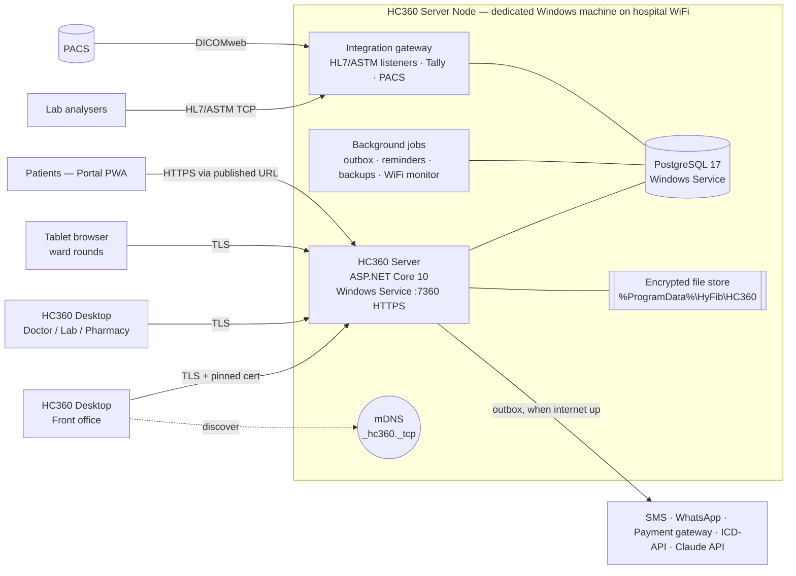
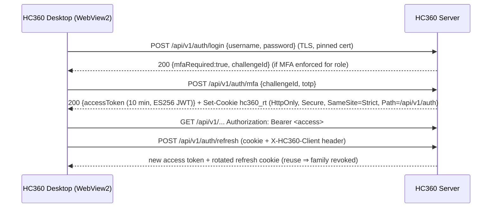

# HyFib HealthCare360 — Architecture

This document describes how HC360 is built. It covers the runtime topology on the dedicated WiFi-connected machine, the code organisation, the module boundaries, the cross-cutting mechanisms (security, audit, resilience) and the conventions every module follows. The decisions behind it are recorded in [DECISIONS.md](DECISIONS.md). Requirements are in [../requirements/SRS.md](../requirements/SRS.md).

---

## 1. Technology stack

| Layer | Choice | Version |
|---|---|---|
| Server runtime | .NET / ASP.NET Core (Minimal APIs, Kestrel, SignalR) hosted as a Windows Service | .NET 10 (LTS) |
| Persistence | PostgreSQL + EF Core + Npgsql (snake_case naming, `xmin` optimistic concurrency) | PostgreSQL 17, EF Core 10 |
| Validation | FluentValidation | 12 |
| Jobs | Hosted services + Quartz.NET (cron schedules) | Quartz 4 |
| Observability | Serilog (file + Windows Event Log), OpenTelemetry (OTLP optional) | — |
| Interop | HL7 FHIR R4 (Firely SDK), fo-dicom / DICOMweb, HL7 v2 + ASTM parsers | — |
| Desktop | WPF shell + Microsoft Edge **WebView2** (same model as the new Microsoft Teams/Outlook) | .NET 10, WebView2 1.0.4191+ |
| UI | React + TypeScript + **Fluent UI v9** (Fluent 2 / Windows 11 design), TanStack Router & Query, React Hook Form + Zod, ECharts | React 19.3, TS 6.0, Vite 8 |
| Portal | Same UI stack, mobile-first PWA, i18n (en, hi) | — |
| Tests | xUnit v3, Shouldly, NSubstitute, Testcontainers (PostgreSQL), Vitest, Testing Library, Playwright | — |

---

## 2. Runtime topology (dedicated machine on WiFi)



**Why this shape.** One dedicated machine keeps operation simple for a hospital IT team: two Windows services (HC360 + PostgreSQL), one data directory, one backup job. Workstations run the thin Desktop shell, which renders UI served by the Server Node, so upgrading the server upgrades every desk. The server keeps working when the internet is down. Only the outbound integrations queue up.

**WiFi-specific mechanisms** (SRS §3):

| Concern | Mechanism | Where |
|---|---|---|
| Find the server without typing IPs | mDNS advertisement `_hc360._tcp.local` (TXT: `ver`, `fac`, `fp`=SHA-256 cert fingerprint) + Desktop discovery | `Platform/Networking/MdnsAdvertiser.cs`, `Desktop/Services/ServerDiscovery.cs` |
| Eavesdropping on shared WiFi | TLS 1.2/1.3 always. A private hospital CA is generated on first start. Desktop pins the fingerprint after enrolment | `Platform/Networking/LanCertificateManager.cs`, `Desktop/MainWindow.xaml.cs` |
| Duplicate side effects from retries | `Idempotency-Key` on every POST/PUT/PATCH/DELETE. The server stores the response for 24 h and replays it | `Platform/Http/IdempotencyFilter.cs`, `web/packages/core/src/api/client.ts` |
| Lost typing on disconnect | Draft auto-save (`useDraft`) every 5 s to local storage, cleared on sign-out | `web/packages/core/src/hooks/useDraft.ts` |
| Silent disconnects | Connection store (browser online/offline + heartbeat + SignalR state), banner and status pill. Desktop reports WiFi SSID/signal through the bridge | `web/apps/staff/src/app/connection/*` |
| Server link quality | `WifiMonitor` samples the WLAN API every 30 s, persists samples, raises alerts | `Platform/Networking/WifiMonitor.cs` |
| Internet outage | Transactional outbox with exponential backoff; integrations never block clinical flows | `Platform/Messaging/Outbox*.cs` |
| Airtime efficiency | Brotli/Gzip response compression, paginated payloads, HTTP caching of static assets (immutable hashed files) | `Server/Program.cs` |

---

## 3. Code organisation

```
HyFib.HealthCare360.slnx                  .NET solution (server, desktop, tests)
Directory.Build.props / Directory.Packages.props   shared build settings, central package versions
src/
  server/
    HyFib.HealthCare360.SharedKernel/     Entity base types, Result/Error, paging, guards (no dependencies)
    HyFib.HealthCare360.Platform/         Cross-cutting: persistence, security, audit, numbering, outbox,
                                          idempotency, files, notifications, realtime, org masters, contracts
    HyFib.HealthCare360.Integrations/     Adapters: SMS, WhatsApp, Tally, payment gateway, POS, PACS,
                                          lab equipment (HL7/ASTM), biometric, barcode/ZPL, ICD-API
    Modules/
      HyFib.HealthCare360.Modules.<Name>/ One project per bounded context (see §4)
    HyFib.HealthCare360.Server/           Composition root: Program.cs, migrations, seeding, Windows Service
  desktop/
    HyFib.HealthCare360.Desktop/          WPF + WebView2 shell, native bridge, discovery, WiFi monitor
  web/                                    pnpm workspace
    apps/staff/                           Staff UI (Desktop + tablets)
    apps/portal/                          Patient Portal
    packages/core/                        API client, auth, bridge, hooks, formatting
    packages/ui/                          Fluent-based design-system components
tests/
  Modules/HyFib.HealthCare360.Modules.<Name>.Tests/   Each module's domain and service tests
  HyFib.HealthCare360.Platform.Tests/     Platform, Integrations and Desktop have their own test projects too
  HyFib.HealthCare360.IntegrationTests/   End-to-end journeys: the whole server in memory over PostgreSQL
  HyFib.HealthCare360.ArchitectureTests/  Module dependency rules and endpoint authorization
deploy/
  docker/                                 Developer PostgreSQL (and optional Orthanc PACS)
  windows/                                Server Node install, firewall, service, backup scripts
docs/                                     SRS, architecture, security, deployment, module guide
```

---

## 4. Modules (bounded contexts)

| Layer | Module project | Covers (SRS) | May depend on |
|---|---|---|---|
| 0 | SharedKernel | — | — |
| 1 | Platform | Identity, users/roles/permissions, devices, facilities, departments, specialities, practitioners, service catalogue, numbering, audit, settings, files, notifications, realtime, printable documents and PDFs | SharedKernel |
| 2 | Integrations (adapters) | SMS, WhatsApp, e-mail, payment gateway, POS, Tally, PACS, lab analysers, labels, ICD, the PDF renderer (headless Edge) | Platform only. Modules never reference it; they use the Platform abstractions it implements |
| 2 | **Patients** | Front Office (FO), patient master/MPI, visits, queue tokens, enquiries, visitors, consents, documents | Platform |
| 2 | **SupplyChain** | Inventory (INV), purchase, stores, indents, vendors, Asset Management (AST) | Platform |
| 2 | **HR** | HRMS (HR), biometric attendance | Platform |
| 3 | **Scheduling** | PMS schedules/appointments, Online Doctor Appointment (OA) | Patients |
| 4 | **Clinical** | EHR, EMR – Physician Desktop, E-Prescribing, Medical Records – ICD (MRD), Master Health Checkup (MHC), clinical orders | Patients, Scheduling, SupplyChain |
| 5 | **Diagnostics** | LIS / Laboratory, Radiology / Medical Imaging, Cardiology | Clinical (+ lower) |
| 5 | **Pharmacy** | OP Pharmacy, IP Pharmacy, pharmacy management, refills | Clinical, SupplyChain (+ lower) |
| 5 | **Inpatient** | ADT, Ward & Bed management, nursing | Clinical (+ lower) |
| 5 | **VirtualCare** | Telehealth, Remote Patient Monitoring | Clinical, Scheduling (+ lower) |
| 6 | **SpecialtyCare** | Operation Theatre, Dialysis, Physiotherapy, Blood Bank | Inpatient, Clinical, SupplyChain (+ lower) |
| 6 | **SupportServices** | CSSD, Dietary, Canteen | Inpatient, HR, SupplyChain (+ lower) |
| 6 | **Engagement** | Healthcare CRM, Feedback, patient portal accounts, campaigns | Scheduling, Clinical (+ lower) |
| 6 | **Quality** | IRMS (incidents, RCA, CAPA, risk register, quality indicators) | Patients, HR (+ lower) |
| 7 | **Billing** | OP Billing, IP Billing, Medical Billing, Insurance, Doctor Fee Accounting | any module of layers 2–6 |
| 8 | **Analytics** | MIS Reports, Managed BI Services | any module |
| 8 | **AI** | AI Voice Assistant (commands + clinical dictation) | Patients, Scheduling, Clinical (+ lower) |
| 8 | **Interop** | HL7 FHIR R4 read API for other providers, with the patient's data-sharing consent (EHR-05) | Patients, Clinical, Diagnostics, Inpatient |
| 8 | **Privacy** | DPDP Act 2023: data-principal requests, nominees, the breach register, the retention schedule and clean-up (PRV-01..04) | Patients, Clinical, Engagement, Billing |

**Rule:** a module may reference only modules in *lower* layers (enforced by `ArchitectureTests`). When a lower module needs something from a higher one (for example, Inpatient needs Billing's discharge clearance, or Pharmacy posts charges), it depends on a **contract interface in Platform** (`Platform/Contracts/*`) that the higher module implements:

| Contract | Implemented by | Used by |
|---|---|---|
| `IChargePoster` — post/cancel billable charges against a visit or admission | Billing | Clinical, Diagnostics, Pharmacy, Inpatient, SpecialtyCare, SupportServices |
| `IBillingStatusProvider` — paid status of order lines, outstanding dues, discharge clearance | Billing | Diagnostics, Inpatient, Front office |
| `INotificationService` — patient/staff notifications (SMS, WhatsApp, e-mail, in-app) | Platform + Integrations | all |
| `IRealtimePublisher` — push events to SignalR groups | Platform | all |
| `IAuditLogger` — explicit PHI-access audit entries | Platform | all |

### 4.1 Inside a module
```
HyFib.HealthCare360.Modules.<Name>/
  <Name>Module.cs            IModule: name, permissions, service registration, endpoint mapping, seeding
  <Name>Permissions.cs       permission constants + registry entries
  Domain/                    entities, enums, value objects, domain rules (no EF / HTTP types)
  Persistence/               IEntityTypeConfiguration<T> classes (schema = module name, snake_case)
  Features/<Feature>/        Endpoints + request/response records + validators + handler logic
  Services/                  module services shared by several features; contract implementations
  Seed/                      reference data seeders (idempotent)
```

---

## 5. Data architecture

* **One PostgreSQL database, one schema per module** (`patients`, `clinical`, `billing`, …), with a single `HospitalDbContext` composed from every module's configurations. Cross-module joins are possible for reporting, but only in the allowed dependency direction.
* **Identifiers:** time-ordered `Guid` v7 primary keys, which index well and are safe to generate on the client or server. An entity gets its `Id` when it is constructed, and `ModelConventions` tells EF Core the key is never generated, so a new child row added to a loaded aggregate (a claim's settlement, a shift's closing totals) is inserted rather than taken for an existing row. Human-facing numbers (UHID, bill no., accession no.) come from `platform.number_series`, which is allocated transactionally (gap-free, facility- and period-aware formats such as `NH-UH-2600123`).
* **Base types:** `Entity` (Id) → `AuditableEntity` (created/updated by/at UTC, soft delete, `Version` mapped to PostgreSQL `xmin` for optimistic concurrency). `IFacilityScoped` entities carry `FacilityId` and get a named EF Core global query filter.
* **Time:** all instants are `timestamptz` (UTC). Dates of birth and similar use `date`. The UI renders in the facility time zone (default `Asia/Kolkata`).
* **Money:** `numeric(18,2)` with `MidpointRounding.AwayFromZero`. Currency is a facility setting (INR).
* **Sensitive identifiers** (Aadhaar, ABHA, policy numbers): AES-256-GCM encrypted columns plus an HMAC-SHA256 blind index for exact-match search. Lists show masked values.
* **Search:** `pg_trgm` GIN indexes on patient name/phone for fuzzy search, plus B-tree indexes on UHID and phone.
* **Audit:** `audit.audit_events` is append-only. A database trigger blocks UPDATE/DELETE. A background sealer computes a SHA-256 hash chain in sequence order, so any tampering is detectable (`/api/v1/admin/audit/verify`).
* **Migrations:** EF Core migrations in `HyFib.HealthCare360.Server/Persistence/Migrations`. They are applied at start-up, after a verified backup of an existing database (`Backup:BeforeMigrations`, on by default); when that backup fails, the database is not changed. A database created by a pre-release build with EnsureCreated, which has no migration history, is adopted: whatever the first migration creates that it lacks and can be added safely is added, and the first migration is recorded as applied (`MigrationBaseline`). Otherwise start-up stops with the list of differences.

---

## 6. API conventions

* Base path `/api/v1/<module>/<resource>`, JSON (camelCase, enums as strings, ISO-8601 UTC).
* **Errors:** RFC 9457 Problem Details. Validation errors are `400` with an `errors` dictionary, then `401`/`403`/`404`, `409` (conflict/concurrency), `422` (business rule), `429` (rate limit).
* **Paging:** `?page=1&pageSize=25&search=&sort=field&desc=true` → `{ items, page, pageSize, totalCount }` (max page size 200).
* **Concurrency:** editable resources expose `version`. Updates send it back, and a mismatch returns `409` with the current state.
* **Idempotency:** the client sends an `Idempotency-Key` UUID for unsafe methods. The server replays stored responses for 24 h and returns `409` if the same key comes with a different payload.
* **Authorisation:** every endpoint declares `.RequirePermission(Permissions.X)`. Anonymous endpoints are explicit (`AllowAnonymous`) and rate-limited.
* **OpenAPI:** `/openapi/v1.json`. There is an interactive reference at `/docs` (Scalar) when enabled.
* **FHIR:** `/fhir/r4/{resource}` read facade for interoperability (EHR-05).
* **Realtime:** SignalR hub `/hubs/events` and `/hubs/telehealth` (WebRTC signalling).
  * Connections join `user:{id}` and `facility:{id}`.
  * Screens subscribe to module topics: `queue:{deptId}`, `patient:{id}`, `beds:{facilityId}`, `ward:{id}`,
    `lab:{facilityId}`, `pharmacy:{facilityId}`, `ot:{facilityId}`, `tele:{sessionId}`.
  * Each module registers a `RealtimeTopicPolicy` for its topics (permission, plus the facility or a record check).
    Topics without a policy cannot be followed.

---

## 7. Security architecture



* **Identity:** local accounts (PBKDF2-SHA512 via ASP.NET Core Identity hasher). Password policy: at least 12 characters and a common-password deny list. Lockout uses exponential backoff. TOTP MFA can be enforced per role. The design leaves room for AD/Entra ID sign-in and fingerprint quick-unlock.
* **Tokens:** ES256-signed JWT access tokens (10 min) carrying user, facility, session and device IDs. **Permissions are resolved server-side** and cached, so revocation is immediate and tokens stay small. Refresh tokens are opaque, stored hashed, rotated on every use, and grouped by family for reuse detection. Sessions have a 12 h absolute limit.
* **Authorisation:** permission strings (`billing.op.create`, `clinical.notes.sign`, …) are declared by modules and grouped into seeded roles. Endpoints enforce them with a dynamic policy provider. Every query is facility-scoped by default.
* **Break-the-glass:** restricted-record access needs a reason and is time-boxed, flagged in the audit log and surfaced to the privacy officer.
* **Transport:** TLS everywhere, including on the LAN, with HSTS. The Desktop shell pins the server certificate fingerprint captured at enrolment and blocks navigation outside the server origin.
* **At rest:** AES-GCM field encryption, an encrypted document store, and encrypted backups. Data Protection keys are protected with machine DPAPI. BitLocker on the Server Node is the hospital's responsibility (SRS SEC-05); nothing checks it yet, and an installer check is planned (`docs/security/ASVS-L2.md`).
* **Web hardening:** strict CSP, `X-Content-Type-Options`, `Referrer-Policy`, `Permissions-Policy` (camera/microphone only for self), `frame-ancestors 'none'`, rate limiting, request size limits, and output encoding (React).
* **Logging hygiene:** every Serilog sink writes through `RedactingFormatter`, which masks the finished line with `SensitiveText` (phone, Aadhaar and ABHA numbers, e-mail and ABHA addresses, tokens and passwords, exception text included); provider error text is masked the same way before it is stored. Errors returned to clients are generic and carry a correlation ID.
* See [../security/SECURITY.md](../security/SECURITY.md) for the threat model.

---

## 8. Desktop shell

`HyFib.HealthCare360.Desktop` is a small WPF application whose main surface is a WebView2 control.

1. **Start-up.** Single instance (a mutex plus a named pipe forwards `hc360://` deep links). Loads `%LocalAppData%\HyFib\HC360\desktop.json` (server URL, pinned fingerprint, device ID). The device secret is DPAPI-protected.
2. **Connect.** Tries the last server, then `https://localhost:7360` (all-in-one), then mDNS discovery. Shows a native connection screen with WiFi SSID/signal, discovered servers, manual address, and enrolment.
3. **Host the UI.** Navigates to the server origin and accepts the server certificate only if its SHA-256 fingerprint matches the pinned value. Other origins open in the system browser after confirmation. Camera and microphone are granted only to the server origin.
4. **Native bridge.** JSON-RPC over `chrome.webview.postMessage`, with methods allow-listed:
   `app.info`, `network.status`, `printer.list`, `printer.printHtml` (silent print to a named printer), `printer.printRaw` (ZPL/ESC-POS), `device.info`, `speech.dictate` (offline Windows speech), `biometric.capture` (RD service), `serial.*` (scanners/analysers), `shell.openExternal`, `notifications.show`. Events pushed to the UI: `network.changed`, `scanner.data`, `deeplink`.
5. **Kiosk mode.** `--kiosk --route=/display/queue` for queue display TVs and self check-in kiosks.

The UI detects the host (`window.chrome?.webview`) and degrades gracefully in a plain browser. For example, printing falls back to `window.print()`.

---

## 9. Web UI architecture (staff app)

* **Shell:** Fluent 2 layout (nav drawer grouped by domain, top bar with global patient search, facility switcher, connection pill, notifications, AI voice button, user menu), a command palette (Ctrl+K), keyboard shortcuts, theme (light/dark/high-contrast following Windows), and an idle lock screen.
* **Modules:** `src/modules/<module>/` contains `manifest.ts` (navigation entries, permissions, commands), `api.ts` (types + TanStack Query hooks), `components/` and `pages/`. Manifests are discovered with `import.meta.glob`, so adding a module needs no shared-file edits. Routes are file-based (`src/routes/_app/<area>/…`), which gives type-safe links.
* **Data:** TanStack Query (server cache, retries, refetch on reconnect), the `@hc360/core` API client (auth refresh, idempotency keys, backoff, Problem Details → form errors), SignalR for pushes. Minimal client state lives in Zustand (session, UI preferences, connection).
* **Forms:** React Hook Form + Zod schemas that mirror the server validators, with draft auto-save for long free-text forms.
* **Design system (`@hc360/ui`):** PageHeader, DataTable (server-side paging, sorting, row actions, keyboard navigation, skeleton/empty/error states), FormSection/FormGrid, typed field components, StatusBadge, KpiCard, PatientBanner, EntityDrawer, ConfirmDialog, PrintDocument (letterhead layouts: A4, A5, 80 mm), Barcode/QR.
* **Accessibility:** Fluent components (ARIA-complete), visible focus, a skip link, reduced-motion support, WCAG 2.2 AA contrast in all themes.

---

## 10. Integration architecture

Each integration is an **abstraction in Platform** (`ISmsSender`, `IWhatsAppSender`, `IPaymentGateway`, `IPosTerminal`, `IAccountingExporter` (Tally), `IPacsClient`, `ILabInstrumentGateway`, `ILabelPrinterService`, `IIcdLookup`). Biometric attendance terminals are the exception: they push to HR directly over the ZKTeco/eSSL ADMS protocol (INT-BIO), so there is no Platform abstraction for them. Each has one or more **providers** in `Integrations` (for example `Msg91SmsSender`, `TwilioSmsSender`, `SimulatorSmsSender`), selected per facility in configuration. Outbound calls go through the outbox dispatcher. Inbound calls (webhooks, analyser messages, device pushes) are authenticated (HMAC signatures, per-device keys, IP allow-lists) and logged to `integrations.message_log` with PHI masked.

**Patient notifications and WhatsApp STOP.** Modules queue patient and staff messages with `INotificationService.Queue(templateKey, recipient, values, channels)`. Each channel gets a `platform.notification_logs` row and an outbox message (`notify.sms`, `notify.whatsapp`, `notify.email`); the outbox handler renders the template and calls the channel's sender. A number that replied **STOP** to the hospital's WhatsApp number has a row in `platform.whatsapp_opt_outs` (one per E.164 number, for the whole group, kept by the `WhatsAppOptOutChanged` integration event that Integrations raises once per new reply; see [integrations.md](../modules/integrations.md#stop-and-start-replies)). Before every WhatsApp send, the `notify.whatsapp` handler checks it: a non-essential message to an opted-out number is not sent, and its log is marked **`Suppressed`** with the reason, instead of failing and retrying. The check runs at delivery time, so messages queued earlier stop too, whichever module queued them. `WhatsAppOptOutPolicy` classifies templates: only messages that must reach the person for security are essential (today `auth.otp`, the portal sign-in code); everything else stops on WhatsApp, including a video consultation's join link, because the patient still has SMS, e-mail and the portal. Template keys that are not listed (module or administrator templates) are non-essential, and a unit test fails when a built-in template is added to `DefaultNotificationTemplates` without a classification. **START** lifts the opt-out. SMS and e-mail are never affected by a WhatsApp reply.

**Documents and PDFs (ADR-012).** Documents that leave the hospital (reports, the health check-up report, prescriptions, discharge summaries, A4 bills, MIS reports) are laid out on the server: each module builds a `PrintableDocument` from its own data with the encoding `Html` builder in `Platform/Documents`, with the letterhead, logo, signatures and QR codes from `DocumentAssets`. The staff app prints that HTML (`GET …/document`), and `IPdfRenderer` turns the same HTML into the PDF (`GET …/pdf`, portal downloads, MIS export). Its implementation, `EdgePdfRenderer` in Integrations, drives headless Microsoft Edge over a private pipe with scripts and network access off. A message can carry a document: `INotificationService.Queue(…, document: new NotificationDocument(kind, id))`, and the module's `INotificationDocumentSource` for that kind makes the PDF when the message is sent. E-mail attaches it; WhatsApp sends it in the template's document header when the template is marked as having one.

---

## 11. Scaling path

1. **Single node** (default): API + jobs + gateway in one process, PostgreSQL on the same machine.
2. **Split roles:** the same binary runs with `--role api|worker|gateway`. Several API nodes sit behind a reverse proxy (IIS ARR/YARP), with a SignalR Redis backplane.
3. **Database:** PgBouncer, a read replica for Analytics (`ConnectionStrings:Reporting`), and monthly partitions for audit/RPM/messages tables.
4. **Multi-hospital:** facilities share the database with row-level facility scoping, or run one database per region. Modules can be extracted as services because they talk only through contracts and events.

---

## 12. Quality gates

* CI (`.github/workflows/ci.yml`) runs on every pull request and on main, and a pull request cannot merge until both of its jobs pass:
  * **.NET:** the C# formatting check (`dotnet format whitespace`, from `.editorconfig`); restore, whose NuGet audit fails on any known-vulnerable package, direct or transitive; `dotnet build` with warnings as errors and every security analyzer rule on; `dotnet test` (unit, integration and architecture).
  * **Web:** a gitleaks secret scan of every commit, `pnpm audit`, the Prettier check (`pnpm format:check`), `pnpm typecheck`, `pnpm lint`, `pnpm test`, `pnpm build`.
* The weekly **Security audit** workflow runs both package audits on main, and Dependabot proposes updates every week. `docs/security/SECURITY.md` ("Dependencies, secrets and code scanning") explains how an advisory is accepted and how a finding is handled.
* Every module ships domain unit tests for its rules (for example billing totals, bed state machine, Westgard rules, FEFO batch selection) and integration tests for its main workflow.
* **End-to-end journeys (SRS §9)** run in `HyFib.HealthCare360.IntegrationTests`.
  * They host the real server composition (`ServerComposition`: every module, the middleware, authorization and endpoints) on an in-memory test server.
  * The database is a new PostgreSQL database, built by the real migrations and seeded with the demonstration data and staff accounts.
  * Each journey signs in as the role that does each step: front office, doctor, lab, pharmacist, billing, nurse. The demonstration data has no pathologist, so the test host has the hospital administrator create that account through the admin API the first time a journey needs it.
  * `OutpatientJourneyTests`: register → appointment → consult → lab → pharmacy → bill.
  * `InpatientJourneyTests`: admit (with insurance and a pre-authorisation) → bed and transfer → charges → discharge bill → insurance claim and settlement.
  * CI runs them on the runner's own PostgreSQL. Locally they use Docker or `HC360_TEST_DATABASE` (see the README).
