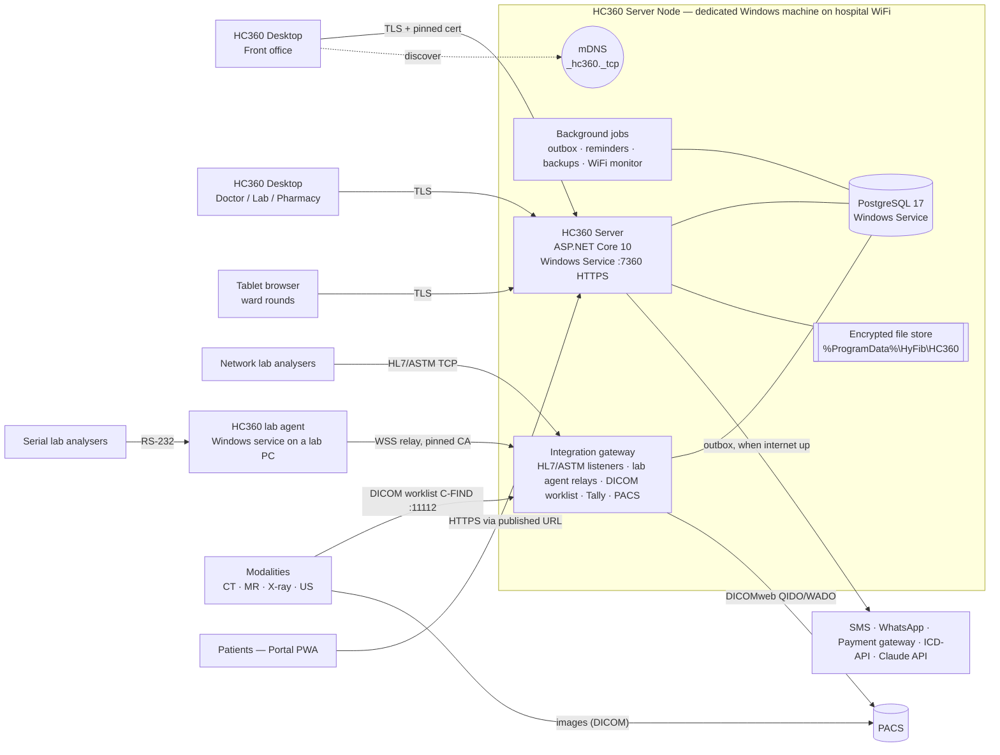
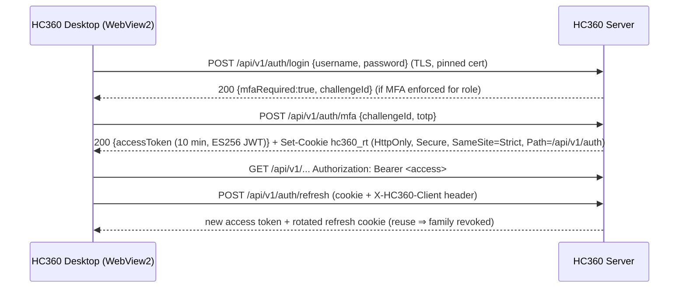

# HyFib HealthCare360 — Architecture

This document describes how HC360 is built. It covers the runtime topology on the dedicated WiFi-connected machine, the code organisation, the module boundaries, the cross-cutting mechanisms (security, audit, resilience) and the conventions every module follows. The decisions behind it are recorded in [DECISIONS.md](DECISIONS.md). Requirements are in [../requirements/SRS.md](../requirements/SRS.md).

---

## 1. Technology stack

| Layer | Choice | Version |
|---|---|---|
| Server runtime | .NET / ASP.NET Core (Minimal APIs, Kestrel, SignalR) hosted as a Windows Service | .NET 10 (LTS) |
| Persistence | PostgreSQL + EF Core + Npgsql (snake_case naming, `xmin` optimistic concurrency) | PostgreSQL 17, EF Core 10 |
| Validation | FluentValidation | 12 |
| Jobs | Hosted services + Quartz.NET (cron schedules) | Quartz 4 |
| Observability | Serilog (file + Windows Event Log), OpenTelemetry (OTLP optional) | — |
| Interop | HL7 FHIR R4 (Firely SDK), fo-dicom (DICOM modality worklist server), DICOMweb (QIDO-RS, WADO-RS), HL7 v2 + ASTM parsers | fo-dicom 5 |
| Desktop | WPF shell + Microsoft Edge **WebView2** (same model as the new Microsoft Teams/Outlook) | .NET 10, WebView2 1.0.4191+ |
| UI | React + TypeScript + **Fluent UI v9** (Fluent 2 / Windows 11 design), TanStack Router & Query, React Hook Form + Zod, ECharts | React 19.3, TS 6.0, Vite 8 |
| Portal | Same UI stack, mobile-first PWA, i18n (en, hi) | — |
| Tests | xUnit v3, Shouldly, NSubstitute, Testcontainers (PostgreSQL), Vitest, Testing Library, Playwright | — |

---

## 2. Runtime topology (dedicated machine on WiFi)



**Why this shape.** One dedicated machine keeps operation simple for a hospital IT team: two Windows services (HC360 + PostgreSQL), one data directory, one backup job. Workstations run the thin Desktop shell, which renders UI served by the Server Node, so upgrading the server upgrades every desk. The server keeps working when the internet is down. Only the outbound integrations queue up.

**WiFi-specific mechanisms** (SRS §3):

| Concern | Mechanism | Where |
|---|---|---|
| Find the server without typing IPs | mDNS advertisement `_hc360._tcp.local` (TXT: `ver`, `fac`, `fp`=SHA-256 cert fingerprint) + Desktop discovery | `Platform/Networking/MdnsAdvertiser.cs`, `Desktop/Services/ServerDiscovery.cs` |
| Eavesdropping on shared WiFi | TLS 1.2/1.3 always. A private hospital CA is generated on first start. Desktop pins the fingerprint after enrolment | `Platform/Networking/LanCertificateManager.cs`, `Desktop/MainWindow.xaml.cs` |
| Duplicate side effects from retries | `Idempotency-Key` on every POST/PUT/PATCH/DELETE. The server stores the response for 24 h and replays it | `Platform/Http/Idempotency.cs`, `web/packages/core/src/api/client.ts` |
| Lost typing on disconnect | Draft auto-save (`useDraft`) every 5 s to local storage, cleared on sign-out | `web/packages/core/src/hooks/useDraft.ts` |
| Silent disconnects | Connection store (browser online/offline + heartbeat + SignalR state), banner and status pill. Desktop reports WiFi SSID/signal through the bridge | `web/apps/staff/src/app/connection/*` |
| Server link quality | `WifiMonitor` samples the WLAN API every 30 s, persists samples, raises alerts | `Platform/Networking/WifiMonitor.cs` |
| Internet outage | Transactional outbox: each message is retried, waiting 10 s doubling to an hour, until it is delivered or expires (7 days, or sooner when its sender says so: a sign-in code with the code, a reminder at the appointment); integrations never block clinical flows | `Platform/Messaging/Outbox*.cs` |
| Airtime efficiency | Brotli/Gzip response compression, paginated payloads, HTTP caching of static assets (immutable hashed files) | `Server/Program.cs` |

---

## 3. Code organisation

```
HyFib.HealthCare360.slnx                  .NET solution (server, desktop, tests)
Directory.Build.props / Directory.Packages.props   shared build settings, central package versions
src/
  server/
    HyFib.HealthCare360.SharedKernel/     Entity base types, Result/Error, paging, guards (no dependencies)
    HyFib.HealthCare360.Platform/         Cross-cutting: persistence, security, audit, numbering, outbox,
                                          idempotency, files, notifications, realtime, org masters, contracts
    HyFib.HealthCare360.Integrations/     Adapters: SMS, WhatsApp, Tally, payment gateway, POS, PACS,
                                          lab equipment (HL7/ASTM), biometric, barcode/ZPL, ICD-API
    Modules/
      HyFib.HealthCare360.Modules.<Name>/ One project per bounded context (see §4)
    HyFib.HealthCare360.Server/           Composition root: Program.cs, migrations, seeding, Windows Service
  desktop/
    HyFib.HealthCare360.Desktop/          WPF + WebView2 shell, native bridge, discovery, WiFi monitor
  web/                                    pnpm workspace
    apps/staff/                           Staff UI (Desktop + tablets)
    apps/portal/                          Patient Portal
    packages/core/                        API client, auth, bridge, hooks, formatting
    packages/ui/                          Fluent-based design-system components
tests/
  Modules/HyFib.HealthCare360.Modules.<Name>.Tests/   Each module's domain and service tests
  HyFib.HealthCare360.Platform.Tests/     Platform, Integrations and Desktop have their own test projects too
  HyFib.HealthCare360.IntegrationTests/   End-to-end journeys: the whole server in memory over PostgreSQL
  HyFib.HealthCare360.ArchitectureTests/  Module dependency rules and endpoint authorization
deploy/
  docker/                                 Developer PostgreSQL (and optional Orthanc PACS)
  windows/                                Server Node install, firewall, service, backup scripts
docs/                                     SRS, architecture, security, deployment, module guide
```

---

## 4. Modules (bounded contexts)

| Layer | Module project | Covers (SRS) | May depend on |
|---|---|---|---|
| 0 | SharedKernel | — | — |
| 1 | Platform | Identity, users/roles/permissions, devices, facilities, departments, specialities, practitioners, service catalogue, numbering, audit, settings, files, notifications, realtime, printable documents and PDFs | SharedKernel |
| 2 | Integrations (adapters) | SMS, WhatsApp, e-mail, payment gateway, POS, Tally, PACS (DICOMweb), the DICOM modality worklist server, lab analysers, labels, ICD, the PDF renderer (headless Edge) | Platform only. Modules never reference it; they use the Platform abstractions it implements |
| 2 | **Patients** | Front Office (FO), patient master/MPI, visits, queue tokens, enquiries, visitors, consents, documents, patient portal scope and family links | Platform |
| 2 | **SupplyChain** | Inventory (INV), purchase, stores, indents, vendors, Asset Management (AST) | Platform |
| 2 | **HR** | HRMS (HR), biometric attendance | Platform |
| 3 | **Scheduling** | PMS schedules/appointments, Online Doctor Appointment (OA) | Patients |
| 4 | **Clinical** | EHR, EMR – Physician Desktop, E-Prescribing, Medical Records – ICD (MRD), Master Health Checkup (MHC), clinical orders | Patients, Scheduling, SupplyChain |
| 5 | **Diagnostics** | LIS / Laboratory, Radiology / Medical Imaging, Cardiology | Clinical (+ lower) |
| 5 | **Pharmacy** | OP Pharmacy, IP Pharmacy, pharmacy management, refills | Clinical, SupplyChain (+ lower) |
| 5 | **Inpatient** | ADT, Ward & Bed management, nursing | Clinical (+ lower) |
| 5 | **VirtualCare** | Telehealth, Remote Patient Monitoring | Clinical, Scheduling (+ lower) |
| 6 | **SpecialtyCare** | Operation Theatre, Dialysis, Physiotherapy, Blood Bank | Inpatient, Clinical, SupplyChain (+ lower) |
| 6 | **SupportServices** | CSSD, Dietary, Canteen | Inpatient, HR, SupplyChain (+ lower) |
| 6 | **Engagement** | Healthcare CRM, Feedback, patient portal accounts, campaigns | Scheduling, Clinical (+ lower) |
| 6 | **Quality** | IRMS (incidents, RCA, CAPA, risk register, quality indicators) | Patients, HR (+ lower) |
| 7 | **Billing** | OP Billing, IP Billing, Medical Billing, Insurance, Doctor Fee Accounting | any module of layers 2–6 |
| 8 | **Analytics** | MIS Reports, Managed BI Services | any module |
| 8 | **AI** | AI Voice Assistant (commands + clinical dictation) | Patients, Scheduling, Clinical (+ lower) |
| 8 | **Interop** | HL7 FHIR R4 read API for other providers, with the patient's data-sharing consent (EHR-05) | Patients, Clinical, Diagnostics, Inpatient |
| 8 | **Privacy** | DPDP Act 2023: data-principal requests, nominees, the breach register, the retention schedule and clean-up (PRV-01..04) | Patients, Clinical, Engagement, Billing |

**Rule:** a module may reference only modules in *lower* layers (enforced by `ArchitectureTests`). When a lower module needs something from a higher one (for example, Inpatient needs Billing's discharge clearance, or Pharmacy posts charges), it depends on a **contract interface in Platform** (`Platform/Contracts/*`) that the higher module implements:

| Contract | Implemented by | Used by |
|---|---|---|
| `IChargePoster` — post/cancel billable charges against a visit or admission | Billing | Clinical, Diagnostics, Pharmacy, Inpatient, SpecialtyCare, SupportServices |
| `IBillingStatusProvider` — paid status of order lines, outstanding dues, discharge clearance | Billing | Diagnostics, Inpatient, Front office |
| `IVerifiedCodingSource` — the medical records coding of an admission or visit, once a second coder has verified it | Clinical | Billing (insurance claims) |
| `INotificationService` — patient/staff notifications (SMS, WhatsApp, e-mail, in-app) | Platform + Integrations | all |
| `IRealtimePublisher` — push events to SignalR groups | Platform | all |
| `IAuditLogger` — explicit PHI-access audit entries | Platform | all |

Billing may reference any module below it, but it references only Patients and Scheduling: it keeps its own record of
admissions from the integration events, and reads the verified coding through `IVerifiedCodingSource` rather than from
Clinical's tables.

### 4.1 Inside a module
```
HyFib.HealthCare360.Modules.<Name>/
  <Name>Module.cs            IModule: name, permissions, service registration, endpoint mapping, seeding
  <Name>Permissions.cs       permission constants + registry entries
  Domain/                    entities, enums, value objects, domain rules (no EF / HTTP types)
  Persistence/               IEntityTypeConfiguration<T> classes (schema = module name, snake_case)
  Features/<Feature>/        Endpoints + request/response records + validators + handler logic
  Services/                  module services shared by several features; contract implementations
  Seed/                      reference data seeders (idempotent)
```

---

## 5. Data architecture

* **One PostgreSQL database, one schema per module** (`patients`, `clinical`, `billing`, …), with a single `HospitalDbContext` composed from every module's configurations. Cross-module joins are possible for reporting, but only in the allowed dependency direction.
* **Identifiers:** time-ordered `Guid` v7 primary keys, which index well and are safe to generate on the client or server. An entity gets its `Id` when it is constructed, and `ModelConventions` tells EF Core the key is never generated, so a new child row added to a loaded aggregate (a claim's settlement, a shift's closing totals) is inserted rather than taken for an existing row. Human-facing numbers (UHID, bill no., accession no.) come from `platform.number_series`, which is allocated transactionally (gap-free, facility- and period-aware formats such as `NH-UH-2600123`).
* **Base types:** `Entity` (Id) → `AuditableEntity` (created/updated by/at UTC, soft delete, `Version` mapped to PostgreSQL `xmin` for optimistic concurrency; edits send back the version they loaded and get 409 when it has moved on, settings, print templates and feature switches included, REL-04). `IFacilityScoped` entities carry `FacilityId` and get a named EF Core global query filter.
* **Time:** all instants are `timestamptz` (UTC). Dates of birth and similar use `date`. The UI renders in the facility time zone (default `Asia/Kolkata`).
* **Money:** `numeric(18,2)` with `MidpointRounding.AwayFromZero`. Currency is a facility setting (INR).
* **Sensitive identifiers** (Aadhaar, ABHA, policy numbers): AES-256-GCM encrypted columns plus an HMAC-SHA256 blind index for exact-match search. Lists show masked values. A blind index comes from the current data key and moves with it after a rotation (`IsBlindIndexOf` names the encrypted column it is computed again from); searches look up every key's index (`BlindIndexes`). Aadhaar, kept only as its last four digits, uses `FixedBlindIndex` on the original key.
* **Search:** `pg_trgm` GIN indexes on patient name/phone for fuzzy search, plus B-tree indexes on UHID and phone.
* **Audit:** `audit.audit_events` is append-only. A database trigger blocks UPDATE/DELETE. A background sealer computes a SHA-256 hash chain in sequence order, so any tampering is detectable (`/api/v1/admin/audit/verify`).
* **Migrations:** EF Core migrations in `HyFib.HealthCare360.Server/Persistence/Migrations`. They are applied at start-up, after a verified backup of an existing database (`Backup:BeforeMigrations`, on by default); when that backup fails, the database is not changed. A database created by a pre-release build with EnsureCreated, which has no migration history, is adopted: whatever the first migration creates that it lacks and can be added safely is added, and the first migration is recorded as applied (`MigrationBaseline`). Otherwise start-up stops with the list of differences.

---

## 6. API conventions

* Base path `/api/v1/<module>/<resource>`, JSON (camelCase, enums as strings, ISO-8601 UTC).
* **Errors:** RFC 9457 Problem Details. Validation errors are `400` with an `errors` dictionary, then `401`/`403`/`404`, `409` (conflict/concurrency), `422` (business rule), `429` (rate limit).
* **Paging:** `?page=1&pageSize=25&search=&sort=field&desc=true` → `{ items, page, pageSize, totalCount }` (max page size 200).
* **Concurrency:** editable resources expose `version`. Updates send it back, and a mismatch returns `409` with the current state.
* **Idempotency:** the client sends an `Idempotency-Key` UUID for unsafe methods. The server replays stored responses for 24 h and returns `422` if the same key comes with a different payload. `IdempotencyTests` retries a registration with the same key and checks that the first answer comes back and no second patient is made (DED-08). A request without a key is not held to this.
* **Authorisation:** every endpoint declares `.RequirePermission(Permissions.X)`. Anonymous endpoints are explicit (`AllowAnonymous`) and rate-limited.
* **OpenAPI:** `/openapi/v1.json`. There is an interactive reference at `/docs` (Scalar) when enabled.
* **FHIR:** `/fhir/r4/{resource}` read facade for interoperability (EHR-05).
* **Realtime:** SignalR hub `/hubs/events` and `/hubs/telehealth` (WebRTC signalling).
  * Connections join `user:{id}` and `facility:{id}`.
  * Screens subscribe to module topics: `queue:{deptId}`, `patient:{id}`, `beds:{facilityId}`, `ward:{id}`,
    `lab:{facilityId}`, `pharmacy:{facilityId}`, `ot:{facilityId}`, `tele:{sessionId}`.
  * Each module registers a `RealtimeTopicPolicy` for its topics (permission, plus the facility or a record check).
    Topics without a policy cannot be followed.

---

## 7. Security architecture



* **Identity:** local accounts (PBKDF2-SHA512 via ASP.NET Core Identity hasher). Password policy: at least 12 characters and a common-password deny list. Lockout uses exponential backoff. TOTP MFA can be enforced per role. The design leaves room for AD/Entra ID sign-in and fingerprint quick-unlock.
* **Tokens:** ES256-signed JWT access tokens (10 min) carrying user, facility, session and device IDs. **Permissions are resolved server-side** and cached, so revocation is immediate and tokens stay small. Refresh tokens are opaque, stored hashed, rotated on every use, and grouped by family for reuse detection. Sessions have a 12 h absolute limit. Start-up refuses settings beyond either ceiling (access tokens 15 min, sessions 12 h; SRS SEC-02).
* **Authorisation:** permission strings (`billing.op.create`, `clinical.notes.sign`, …) are declared by modules and grouped into seeded roles. Endpoints enforce them with a dynamic policy provider. Every query is facility-scoped by default.
* **Break-the-glass:** restricted-record access needs a reason and is time-boxed, flagged in the audit log and surfaced to the privacy officer.
* **Transport:** TLS everywhere, including on the LAN, with HSTS. The Desktop shell pins the server certificate fingerprint captured at enrolment and blocks navigation outside the server origin.
* **At rest:** AES-GCM field encryption, an encrypted document store, and encrypted backups. Data Protection keys are protected with machine DPAPI. BitLocker on the Server Node is the hospital's responsibility (SRS SEC-05); nothing checks it yet, and an installer check is planned (`docs/security/ASVS-L2.md`).
* **Web hardening:** strict CSP, `X-Content-Type-Options`, `Referrer-Policy`, `Permissions-Policy` (camera/microphone only for self), `frame-ancestors 'none'`, rate limiting, request size limits, and output encoding (React).
* **Logging hygiene:** every Serilog sink writes through `RedactingFormatter`, which masks the finished line with `SensitiveText` (phone, Aadhaar and ABHA numbers, e-mail and ABHA addresses, tokens and passwords, exception text included); provider error text is masked the same way before it is stored. Errors returned to clients are generic and carry a correlation ID.
* **Correlation IDs (OBS-04):** the web apps send `X-Correlation-Id` with every request (the same on each retry) and show the server's echo as the reference on errors. The server takes it, or makes one, before anything else runs, so the request log and the exception handler's entries carry it; it is stored on audit rows and outbox messages, and sent on the server's calls to outside services (`CorrelationIdForwardingHandler`), outbox sends included.
* See [../security/SECURITY.md](../security/SECURITY.md) for the threat model.

---

## 8. Desktop shell

`HyFib.HealthCare360.Desktop` is a small WPF application whose main surface is a WebView2 control.

1. **Start-up.** Single instance (a mutex plus a named pipe forwards `hc360://` deep links). Loads `%LocalAppData%\HyFib\HC360\desktop.json` (server URL, pinned fingerprint, device ID). The device secret is DPAPI-protected.
2. **Connect.** Uses the last server it set up. Setup finds servers through mDNS discovery and lists "This computer" when something listens on port 7360 locally (all-in-one; multicast does not always loop back to the sender), or takes a typed address. Shows a native connection screen with WiFi SSID/signal, discovered servers, manual address, and enrolment. The shell remembers the addresses the server answered on, newest first, with the others discovery found for it. When the staff app cannot load and three pinned checks in a row get no answer, it tries those, this computer (by name and `localhost`), and servers announcing the pinned CA over mDNS, once a minute, each over a connection pinned to the hospital CA with a trust of its own (a stranger at an old address is passed over rather than locking the window). The first where the server answers becomes the server, and the main window opens again on it (`ServerFallback`, SRS DED-03). Not when IT fixed the server in the machine policy, and not while the staff app is loaded.
3. **Host the UI.** Navigates to the server origin. The view accepts a server certificate only if it chains to the pinned hospital CA. WebView2 asks the shell only about certificates Windows rejects, so the shell also checks the connection with its own pinned client before it loads the staff app and every 10 seconds after; a certificate from any other CA, even one Windows trusts, unloads the staff app and locks the window until a check passes. Other origins open in the system browser after confirmation. A server page the staff app opens in a new window (the chart or the notes beside a video call) opens in a second HC360 window that shares the profile and follows the same rules, closes with the main window and when it locks; kiosks keep one window. Camera and microphone are granted only to the server origin.
4. **Native bridge.** JSON-RPC over `chrome.webview.postMessage`, with methods allow-listed:
   `device.info`, `network.status`, `printer.list`, `printer.getSetup` and `printer.saveSetup` (the workstation's printer for labels, wristbands, receipts and documents, or the IT policy's), `printer.printHtml` (silent print to a named printer), `printer.printRaw` (ZPL, TSPL or ESC/POS); both print methods accept only printers installed on the workstation, `scanner.getSetup` and `scanner.saveSetup` (the workstation's serial barcode scanner, or the IT policy's), `speech.dictate` (offline Windows speech), `dsc.signPrescription` (a detached CMS signature of a prescription's canonical bytes with the doctor's DSC, chosen in the Windows certificate dialog from the "My" store; the token asks for its PIN), `shell.openExternal`, `notifications.show`. Events pushed to the UI: `network.changed`, `scanner.scan`. Deep links reach the running window through the named pipe, not the bridge.
   Barcode scanners that work as keyboards need nothing. A scanner on a COM port is read by the shell, which hands each
   scan to the staff app to type into the focused field (`scanner.scan`). Serial lab analysers are relayed by the HC360
   lab agent (see §10), which keeps running when nobody is signed in.
5. **Kiosk mode.** `--kiosk --route=/display/queue` for queue display TVs and self check-in kiosks.

The UI detects the host (`window.chrome?.webview`) and degrades gracefully in a plain browser. For example, printing falls back to `window.print()`.

---

## 9. Web UI architecture (staff app)

* **Shell:** Fluent 2 layout (nav drawer grouped by domain, top bar with global patient search, facility switcher, connection pill, notifications, AI voice button, user menu), a command palette (Ctrl+K), keyboard shortcuts, theme (light/dark/high-contrast following Windows), and an idle lock screen that keeps the screens behind it as they were and unlocks with the PIN, the password or, where the hospital turns it on, Windows Hello (WebAuthn; SRS UX-11). Under the top bar, a banner says when the server cannot be reached, and another, which the user can hide, when the connection has stayed weak for 15 seconds (live updates off, or a WiFi signal under 40%) (DED-07).
* **Modules:** `src/modules/<module>/` contains `manifest.ts` (navigation entries, permissions, commands), `api.ts` (types + TanStack Query hooks), `components/` and `pages/`. Manifests are discovered with `import.meta.glob`, so adding a module needs no shared-file edits. Routes are file-based (`src/routes/_app/<area>/…`), which gives type-safe links.
* **Data:** TanStack Query (server cache, retries, refetch on reconnect), the `@hc360/core` API client (auth refresh, idempotency keys, backoff, Problem Details → form errors), SignalR for pushes. Minimal client state lives in Zustand (session, UI preferences, connection).
* **Forms:** React Hook Form + Zod schemas that mirror the server validators, with draft auto-save for long free-text forms.
* **Design system (`@hc360/ui`):** PageHeader, DataTable (server-side paging, sorting, row actions, keyboard navigation, skeleton/empty/error states), FormSection/FormGrid, typed field components, StatusBadge, KpiCard, PatientBanner, EntityDrawer, ConfirmDialog, Barcode/QR.
* **Printing (`@hc360/core`):** `printDocument` lays out a page (A4, A5, 80 mm, labels, wristbands), `letterheadHtml` puts the facility letterhead at its top, and both follow the print templates set in Hospital setup (pre-printed stationery, logo, closing note; HMS-04, UX-09). `printHtml` sends the page to this computer's printer for that kind of page inside HC360 Desktop, or to the print dialog in a browser. Documents patients receive are made on the server instead (ADR-012).
* **Accessibility (UX-10):** Fluent components (ARIA-complete), visible focus, a skip link, reduced-motion support, WCAG 2.2 AA contrast in all themes. axe-core checks the shared components, the staff shell, the main staff screens and the portal's main pages for WCAG 2.2 A/AA problems in the Vitest suites. Playwright checks the built apps' key screens in Chromium, in every theme, for what jsdom cannot measure: colour contrast, 24 px targets, and a visible, unobscured focus at every Tab stop (`pnpm test:a11y`, FRONTEND-GUIDE.md §6).

---

## 10. Integration architecture

Each integration is an **abstraction in Platform** (`ISmsSender`, `IWhatsAppSender`, `IPaymentGateway`, `IPosTerminal`, `IAttendanceTerminalClient`, `IAccountingExporter` (Tally), `IPacsClient`, `ILabelPrinterService`, `IIcdLookup`). Lab analysers are the other way round: Diagnostics implements `IInstrumentResultSink` (results, host queries, orders to send) and asks for orders through the `lab.analyser.order` outbox message, and the analyser gateway in Integrations calls it. The DICOM modality worklist server likewise reads the studies to be done through `IModalityWorklistSource`, which Diagnostics implements. Biometric attendance terminals that can push send their punches to HR directly over the ZKTeco/eSSL ADMS protocol (INT-BIO); those that cannot are read by HR through `IAttendanceTerminalClient` (ZKTeco protocol on TCP 4370). Each has one or more **providers** in `Integrations` (for example `Msg91SmsSender`, `TwilioSmsSender`, `SimulatorSmsSender`), selected per facility in configuration. Outbound calls go through the outbox dispatcher. Inbound calls (webhooks, analyser messages, device pushes) are authenticated (HMAC signatures, per-device keys, IP allow-lists) and logged to the platform's `integration_logs` with PHI masked.

**Lab analysers (INT-LAB).** The analyser protocols (HL7 v2 over MLLP, ASTM E1381/E1394) always run on the server, in the Integrations module. A network analyser connects to a port the gateway listens on. A serial analyser is cabled to a lab PC that runs the **HC360 lab agent** (`src/agent`, a Windows service separate from HC360 Desktop, enrolled as a device of kind `LabAgent`). The agent relays the COM port's bytes over a WebSocket (`/api/v1/integrations/lab/agent/relay/{code}`) that trusts only the pinned hospital CA, and never answers the analyser itself, so acknowledgements, host queries and orders behave the same on both transports. Orders for bidirectional analysers wait in `integrations.lab_order_downloads` until the analyser is connected. See [integrations.md](../modules/integrations.md#laboratory-analysers-int-lab).

**Patient notifications and WhatsApp STOP.** Modules queue patient and staff messages with `INotificationService.Queue(templateKey, recipient, values, channels)`. Each channel gets a `platform.notification_logs` row and an outbox message (`notify.sms`, `notify.whatsapp`, `notify.email`); the outbox handler renders the template and calls the channel's sender. A number that replied **STOP** to the hospital's WhatsApp number has a row in `platform.whatsapp_opt_outs` (one per E.164 number, for the whole group, kept by the `WhatsAppOptOutChanged` integration event that Integrations raises once per new reply; see [integrations.md](../modules/integrations.md#stop-and-start-replies)). Before every WhatsApp send, the `notify.whatsapp` handler checks it: a non-essential message to an opted-out number is not sent, and its log is marked **`Suppressed`** with the reason, instead of failing and retrying. The check runs at delivery time, so messages queued earlier stop too, whichever module queued them. `WhatsAppOptOutPolicy` classifies templates: only messages that must reach the person for security are essential (today `auth.otp`, the portal sign-in code); everything else stops on WhatsApp, including a video consultation's join link, because the patient still has SMS, e-mail and the portal. Template keys that are not listed (module or administrator templates) are non-essential, and a unit test fails when a built-in template is added to `DefaultNotificationTemplates` without a classification. **START** lifts the opt-out. SMS and e-mail are never affected by a WhatsApp reply.

**Documents and PDFs (ADR-012).** Documents that leave the hospital (reports, the health check-up report, prescriptions, discharge summaries, A4 bills, MIS reports) are laid out on the server: each module builds a `PrintableDocument` from its own data with the encoding `Html` builder in `Platform/Documents`, with the letterhead, logo, signatures and QR codes from `DocumentAssets`. The staff app prints that HTML (`GET …/document`), and `IPdfRenderer` turns the same HTML into the PDF (`GET …/pdf`, portal downloads, MIS export). Its implementation, `EdgePdfRenderer` in Integrations, drives headless Microsoft Edge over a private pipe with scripts and network access off. A message can carry a document: `INotificationService.Queue(…, document: new NotificationDocument(kind, id))`, and the module's `INotificationDocumentSource` for that kind makes the PDF when the message is sent. E-mail attaches it; WhatsApp sends it in the template's document header when the template is marked as having one.

**Text for patients in their language (PP-06).** The text the server writes for patients is in English or Hindi, from
one catalogue per language (`Platform/Localization/Resources/patient-texts-{en,hi}.json`, `PatientTexts`; another
language is one more file). `RequestLanguageMiddleware` picks the language of a patient-facing request (portal, public
and OTP endpoints, the portal app, a patient's sign-in): the language chosen in the portal (`X-HC360-Language`, sent
with every portal call), else the preferred language on the signed-in patient's record, else Accept-Language, else
English. `ProblemLocalization` then writes that request's Problem
Details title, detail and field messages in it, matched on their English text, and keeps the machine `code`. Documents
take a `DocumentText` (their labels in one language): the portal's PDFs use the request's language, the copies sent
in messages the record's preference, the staff app English; the prescription is always English and Hindi (ERX-04).
A document with Devanagari text in it embeds Noto Sans Devanagari (`DocumentFonts`), and the browser shapes it. Staff
answers are not touched.

---

## 11. Scaling path

1. **Single node** (default): API + jobs + gateway in one process, PostgreSQL on the same machine.
   * **Warm standby (optional, DED-20):** a second Server Node keeps a read-only copy of the database through PostgreSQL physical streaming replication, over TLS (`sslmode=verify-ca` against the primary's own certificate), as `hc360_replicator`, which pg_hba.conf and the firewall take from the standby's address alone. A replication slot keeps the WAL the standby still needs, up to `max_slot_wal_keep_size`. HC360 is installed there with its service disabled, and refuses to start on a database in recovery. Failover is manual: fence the old primary, promote the standby, put the data keys and documents back from the latest backup (they are not in the database), start HC360. The DSC trust folder (the CCA India roots, ERX-04) is in neither the database nor the backups: IT copies it to the standby at set-up, and System health warns while it is empty and DSC signing is on (Clinical adds that warning through Platform's `IHealthWarningSource`). The hospital CA is exported once with a password and imported on the standby (`certificates export-ca/import-ca`), so the standby issues itself a certificate workstations trust, and HC360 Desktop finds it by the CA it announces over mDNS (`ServerFallback`). Optional WAL archiving (`archive_timeout` 15 min) gives a recovery point within 15 minutes for point-in-time recovery (REL-02). System health warns from the slot and `pg_stat_archiver`, which the server's own account may read. Scripts: `deploy/windows/Enable-HC360Replication.ps1`, `New-HC360Standby.ps1`; runbook: [DEPLOYMENT.md §9](../deployment/DEPLOYMENT.md#9-warm-standby-and-failover-optional).
2. **Split roles (SCAL-05):** the same binary runs with `--role all|api|worker` (the setting `HealthCare360:Role`; the switch wins over the settings file, and an unknown role stops start-up). `api` serves the API, hubs and apps and runs no background jobs (outbox, audit sealing, partition upkeep, idempotency and cluster-store clean-up, backups, Wi-Fi monitor, analyser and worklist listeners). `worker` runs those jobs, maps no API endpoints, hubs, apps or API reference, and answers only `/health/live` and `/health/ready`; it does not advertise itself over mDNS. Run exactly one node that runs jobs (`all` or `worker`): nightly backups are not coordinated between nodes. There is no separate gateway role; integrations run in whichever node handles the request or the outbox.
3. **Several API nodes (SCAL-01, SCAL-02):** stateless API nodes behind a reverse proxy (IIS ARR, YARP or nginx), one worker, one database. Runbook: [DEPLOYMENT.md §10](../deployment/DEPLOYMENT.md#10-several-servers-behind-a-reverse-proxy-optional).
   * **Nothing per user lives in one node's memory.** Sessions, MFA challenges, one-time codes and lockouts were in the database already; break-the-glass grants (`patients.break_glass_grants`) moved there from the memory cache; a new backup recovery key waiting to be typed back is in the shared keys folder (`keys/backup-recovery.pending`, wrapped by the shared Data Protection ring, made and confirmed under the key advisory lock), so the confirmation may reach any node. Caches kept for speed (permissions 2 min, session state 30 s, settings 1 min) are expired on every node at once through PostgreSQL `LISTEN/NOTIFY` on channel `hc360_cache` (`IClusterSignals`, `IClusterCache`): a change publishes its topic and key once it is committed (published earlier, another node could re-read and cache the old row with nothing to expire it again), each node expires its entry, and a read that overlapped a change is not cached. Each node pings itself on the channel every 15 s; a node that has not heard itself for 45 s (database away, or PgBouncer in transaction mode, which drops notifications: point `ConnectionStrings:Signals` at PostgreSQL) bypasses the caches until it hears again, and expires everything when it does.
   * **Shared short-lived state: `IClusterStore`** (`Platform/Persistence/ClusterStore.cs`, table `platform.cluster_entries`). For what must hold whichever node answers: `TryAddAsync(key, lifetime)` adds a key once (true for exactly one caller on any node until it expires: spending a one-time token or a solved challenge), `IncrementAsync(key, window)` counts atomically in a fixed window (attempt counters, per-address limits) and returns the count and the window's end, `IncrementUntilQuietAsync(key, quiet)` counts until a quiet spell (each count moves the end on: failure counts), `GetCountAsync` and `RemoveAsync`. Each call is one `INSERT … ON CONFLICT` statement on a connection of its own, outside the caller's transaction; keys are the caller's, prefixed by purpose, at most 200 characters, with hashes instead of personal identifiers; the worker deletes expired rows every 10 minutes. The per-address limits on sign-in (10 a minute) and one-time codes (5 in 15 minutes) count there on a node of several (`ClusterRateLimits`, `RequireAddressRateLimit`), as well as in ASP.NET Core's in-memory limiter; the other rate limits (public, device, per user) stay per node. The portal's anti-automation (SEC-06) keeps its spent challenges (`pow:spent:`), failure counts (`pow:fail:`, keyed hashes of addresses and numbers) and audit throttle (`pow:audited:`) there on a node of several, so a challenge is spent once and failures count for the hospital; past the count that asks for the most work, a node writes a failure once a minute, so a flood of refusals is not a flood of statements. A single Server Node keeps the same entries in `MemoryClusterStore`, the same contract in memory (ScaleOutTests runs one script against both and compares the answers). It is PostgreSQL rather than Redis on purpose: every node already has the database, and these checks must not fail open when the optional Redis is away.
   * **Keys:** the keys (data encryption keys, token signing key, backup recovery key) and the stored documents live in `HealthCare360:Cluster:SharedDirectory` (a file share), and the Data Protection key ring that wraps the keys is there too, protected with a certificate every node holds (`KeyCertificateThumbprint` or `KeyCertificatePath`) instead of machine DPAPI. The ring is deliberately not in the database, so a database copy (backup, replica, standby) opens nothing without the share. Each node keeps its own TLS certificate and hospital CA under its own ring. A rotation on one node is picked up by the others within 10 s, at once for a token or value naming a key they do not know yet (a node notes how the key files looked before it reads them, so a rotation landing mid-read shows as a change at its next look); key changes take a PostgreSQL advisory lock. A node with its own data key refuses to start on a share without one. `/health/ready` checks the share.
   * **Real time:** with `ConnectionStrings:Redis`, SignalR uses the StackExchange.Redis backplane (channel prefix `hc360`), so an event raised on any node, the worker included, reaches clients on every other. Redis away does not stop a node: it connects in the background, `/health/ready` reports the backplane *Degraded* (still 200), and an event that cannot be sent is logged without failing the change that raised it (REL-03). The proxy keeps a client on one node for `/hubs/` (negotiate and connect must meet), and passes WebSockets.
   * **Client address:** behind the proxy, `X-Forwarded-For` and `X-Forwarded-Proto` are honoured only from `HealthCare360:Network:KnownProxies`/`KnownNetworks` (`ReverseProxy`), so rate limits, the audit trail and address allow-lists see the real client and nobody else can claim an address. Off when no proxy is named. Per-address limits and the proof of work count by `ClientAddresses`: an IPv6 address from outside the hospital by its /64 (a client holds the whole prefix), an IPv4 address carried in IPv6 as that address, and the hospital's own network (link-local, unique local, the server's own /64s, `Network:LocalNetworks`) address by address.
4. **Database:** PgBouncer, a read replica for MIS/BI (`ConnectionStrings:Analytics`, or the older `Reporting`, SCAL-03): every report, KPI and report look-up runs there through `ReportingDbContextFactory.RunAsync`, and on the primary when the replica cannot be reached or goes away during the read (not for a query error, nor for a query that runs past its time on the replica), labelled "Live database (reporting replica unavailable)" and not cached. **Monthly partitions (SCAL-04)** of `audit.audit_events` (`occurred_at`), `virtualcare.rpm_readings` (`measured_at`), `platform.notification_logs` and `integrations.integration_logs` (`created_at`): declarative range partitions per UTC month, named `<table>_YYYY_MM`, plus `<table>_default`. PostgreSQL wants the partition key in every primary key and unique index and allows no foreign key into a partitioned table, so the primary keys are `(id, <time>)`, in EF Core's model too, so every UPDATE it writes names the row's month and PostgreSQL reads that one partition (by the id alone it looks in every month's: with ten years of months the audit sealer took 2.3 to 2.7 s per 500 events, and takes 0.4 to 0.6 s with the time; `PartitionMaintenanceTests` checks the plan). Nothing references these rows by foreign key: campaign recipients and RPM alerts keep the id without one; `rpm_readings`' unique `(enrollment_id, type, measured_at)` already includes it, and the audit chain position is indexed but not unique; its uniqueness is enforced by the advisory lock the sealer takes and by the deferred chain-link trigger, which refuses a position already taken. That trigger looks the position up in every month's partition, twice per sealed event (some 0.8 ms each with ten years of months), which bounds sealing at about 1,000 events a second, far above a hospital's audit rate; the sealer reads the end of the chain only when something waits to be sealed. The migration `PartitionHighVolumeTables` rebuilds each table in one transaction (copy, count check, swap, indexes, foreign keys and triggers from the old table's own definitions, identity sequence carried over) and `Down` reverses it. The worker's `PartitionMaintenance` keeps partitions `HealthCare360:Partitions:MonthsAhead` (3) ahead, moves rows that waited in the default partition into a new month (detach, copy, attach, so the audit trail sees no UPDATE or DELETE), and gives each audit partition its TRUNCATE trigger. It never drops a partition: deleting stays with the Privacy module's `RetentionService` (legal minimums, medical records to review, an audited run), whose deletes by `created_at` the partitions keep to the months concerned. `PartitionMigrationTests` proves the migration keeps every row (count and md5 of every row in id order), routes rows by month and reverses cleanly.
5. **Multi-hospital:** facilities share the database with row-level facility scoping, or run one database per region. Modules can be extracted as services because they talk only through contracts and events.

---

## 12. Quality gates

* CI (`.github/workflows/ci.yml`) runs on every pull request and on main, and a pull request cannot merge until its jobs pass:
  * **.NET:** the C# formatting check (`dotnet format whitespace`, from `.editorconfig`); restore, whose NuGet audit fails on any known-vulnerable package, direct or transitive; `dotnet build` with warnings as errors and every security analyzer rule on; `dotnet test` (unit, integration and architecture).
  * **Web:** a gitleaks secret scan of every commit, `pnpm audit`, the Prettier check (`pnpm format:check`), `pnpm typecheck`, `pnpm lint`, `pnpm test`, `pnpm build`.
  * **Accessibility in a browser (SRS UX-10):** `pnpm test:a11y` on Ubuntu with Playwright's Chromium: the staff app's and the portal's key screens, built and with canned data, in the light, dark and high-contrast themes, checked with axe-core (every WCAG 2.2 A/AA rule, contrast and target size included) and a walk with Tab. A failure keeps the HTML report, with screenshots and traces, as a build artifact.
* **CodeQL** code scanning analyses the C# apps, the web apps and the workflows on every pull request, on main and weekly.
* The weekly **Security audit** workflow runs both package audits on main, and Dependabot proposes updates every week. `docs/security/SECURITY.md` ("Dependencies, secrets and code scanning") explains how an advisory is accepted and how a finding is handled.
* Every module ships domain unit tests for its rules (for example billing totals, bed state machine, Westgard rules, FEFO batch selection) and integration tests for its main workflow.
* **End-to-end journeys (SRS §9)** run in `HyFib.HealthCare360.IntegrationTests`.
  * They host the real server composition (`ServerComposition`: every module, the middleware, authorization and endpoints) on an in-memory test server.
  * The database is a new PostgreSQL database, built by the real migrations and seeded with the demonstration data and staff accounts.
  * Each journey signs in as the role that does each step: front office, doctor, lab, pharmacist, billing, nurse. The demonstration data has no pathologist, so the test host has the hospital administrator create that account through the admin API the first time a journey needs it.
  * `OutpatientJourneyTests`: register → appointment → consult → lab → pharmacy → bill.
  * `InpatientJourneyTests`: admit (with insurance and a pre-authorisation) → bed and transfer → charges → discharge bill → insurance claim and settlement.
  * `TeleconsultationJourneyTests`: video booking → join link → call and telehealth visit → e-prescription, which reaches the patient once on WhatsApp and once by SMS.
  * CI runs them on the runner's own PostgreSQL. Locally they use Docker or `HC360_TEST_DATABASE` (see the README).
