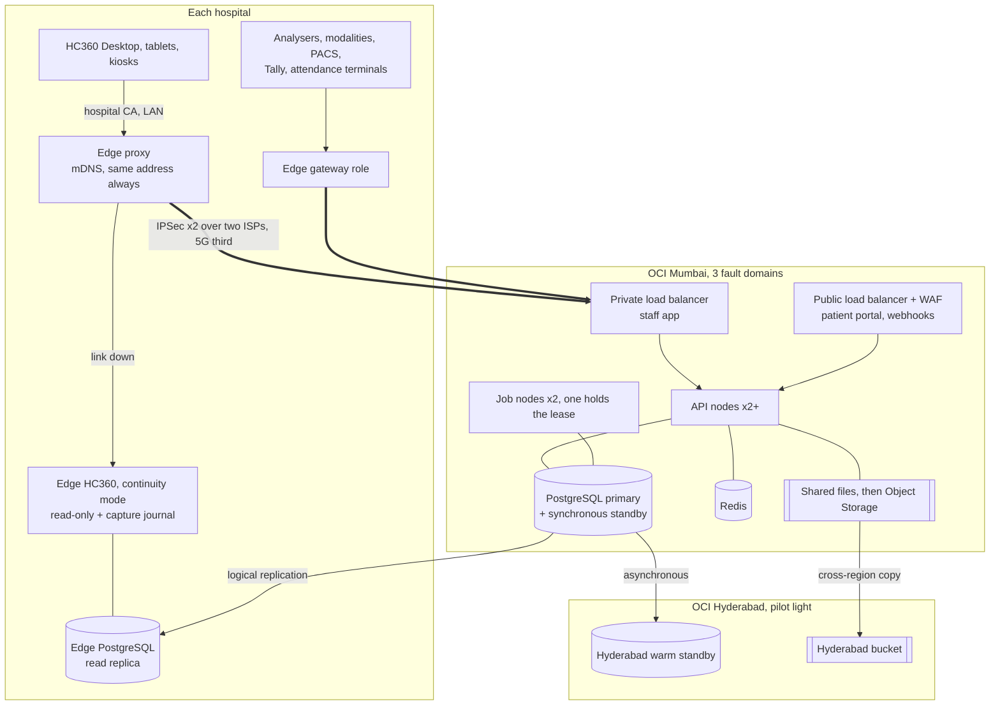

# HC360 in the cloud, with the hospital still working when the link is down

**Status: proposed, not decided.** This plan reverses ADR-001 and SRS revision 2.0 ("anything … that implied a
cloud-hosted SaaS … is superseded"). Nothing here is built. It is written from the code and the runbooks as they stand
on 10 November 2026, and says where a figure or a claim could not be checked.

## 1. The decision in one page

Run the system of record in **OCI Mumbai**, with a warm standby in **OCI Hyderabad**, and keep a small **edge node in
each hospital** that (a) is the address every workstation talks to, (b) hosts what must stay on the hospital network
(analysers, modalities, PACS, Tally, attendance terminals), and (c) carries the hospital through a link outage: a
read-only copy of the whole record at once, and a bounded set of entries captured locally and replayed afterwards.

It is not a general two-way database sync. HC360's rules (gap-free GST bill series, the stock ledger, the bed state
machine, the hash-chained audit trail, `xmin` versions) assume one writer. Two writers that merge later would break
them silently. So the plan keeps **one writer (the cloud)** and treats an outage the way the hospital already does on
paper, only electronically: numbers reserved ahead, entries made against them, and each entry re-validated by the
server when it arrives. Hosted hospital systems are run this way: a hosted primary, redundant circuits, read-only
continuity on site, and back-entry.

| Target | Today (SRS REL-01/02) | This plan |
|---|---|---|
| Availability of the service | 99.5 %, one machine | 99.95 % for the cloud tier (design target; OCI's own SLAs to be read from the contract) |
| What the hospital sees | Same as the machine | The WAN decides: two independent links plus 5G, and the edge for when all three fail |
| Data lost on a failure (RPO) | 24 h, or 15 min with WAL archiving | 0 within Mumbai (synchronous standby), seconds to Hyderabad |
| Time to recover (RTO) | 4 h; ~30 min with a manual standby | Under 2 min within Mumbai (automatic), under 1 h to Hyderabad (decided by a person) |
| Link down at the hospital | Not applicable (server is in the building) | Read-only at once; registration, visits, bills, receipts, admissions, transfers and nursing charting captured and replayed |

**The alternative, stated fairly.** If Nana Hospitals is one site and will stay one, keeping the writer in the building
and using the cloud as standby, backup target and portal host gives full-function offline working with almost no new
code (section 9). The cloud-primary plan is the better one when there are, or will be, several branches sharing one
record (SRS HMS-01, SCAL-06), or when the hospital does not want to keep a server room. That is the hospital's call,
and it should be made on the outage log, not on preference (section 10, question 1).

## 2. What the code already gives, and what it does not

Found in the code, not taken from the documents' summaries:

**Already there**
- Several API nodes on one database, with a job node chosen by a PostgreSQL advisory-lock lease (`Platform/Hosting/JobLeadership.cs`), `--role all|api|worker`, a Redis SignalR backplane, shared rate limits, and cache expiry over `LISTEN/NOTIFY`. This turns on with `HealthCare360:Cluster:SharedDirectory`.
- Sessions, challenges, idempotency records and one-time tokens in the database; outbox claimed with `FOR UPDATE SKIP LOCKED`.
- Every server project targets `net10.0`; the Windows calls are guarded with `OperatingSystem.IsWindows()`.
- `/health/live`, `/health/ready`, OTLP export, forwarded-header support, a reporting replica connection.
- Guid v7 keys made in process (safe to create away from the database), facility scoping on about 230 entities.
- Downtime continuity: number blocks reserved ahead from the real series (`INumberSeries.ReserveAsync`), back-entry with `paper {number, at}`, back-entry windows, the nightly downtime pack, an encrypted read-only offline copy in the staff app, and the Quality module's downtime log (availability, time to restore, time to back-entry).

**Not there**
- No Dockerfile, and the server has never been built or tested on Linux: every .NET CI job runs on `windows-latest`.
- Documents are files on a disk or share (`EncryptedFileStore` is the only `IFileStore`); so are the keys, the audit anchors and the erasure ledger.
- Key protection is machine DPAPI, or a certificate from the Windows store or a PFX in cluster mode.
- PDFs come from headless Edge found through the registry; on Linux the path must be set, and whether the private pipe (`DevToolsPipe.cs`) works with Linux Chrome is untested.
- No write can complete while the server is unreachable: the client retries three times and stops. The lab agent drops what an analyser sends while it has no relay.
- The server refuses to start on a database in recovery, so a replica cannot serve the read-only app today.
- The analyser listeners, the modality worklist server and the attendance pull run only inside the one job node; there is no gateway role.
- HC360 Desktop pins the hospital's private CA and needs the server to hand that CA out; a server with only a public certificate cannot enrol a Desktop.
- Backups are `pg_dump` archives to a folder; idempotency records live 24 h.

## 3. Target architecture

**Cloud tier (Mumbai)**
- *Compute*: the existing binary in Linux containers. Two API nodes (`--role api`) and two job-capable nodes (`--role worker`) spread over the three fault domains; the job lease already moves the jobs within 45 s. Plain VMs in an instance pool with a container runtime are enough at this size; OKE is justified only once there are several environments to run.
- *Database*: PostgreSQL 17 with a synchronous standby in another fault domain and automatic failover, point-in-time recovery, and `pg_trgm`. Direct connections, not a transaction pooler: the lease and `LISTEN/NOTIFY` need them. `idle_session_timeout` must be settable.
- *Shared state*: Redis for SignalR and rate limits (both already degrade safely without it); OCI File Storage as the `Cluster:SharedDirectory` first, because it needs no code; documents move to Object Storage in phase 2.
- *Keys*: the cluster key certificate as a PFX delivered from OCI Vault to each node at start (`KeyCertificatePath`). The Data Protection ring stays out of the database, as ADR-013 requires.
- *Network*: the staff app is never on the internet. It is reached only through the hospital's tunnels, on a private load balancer. The patient portal, payment and WhatsApp webhooks and ABDM callbacks come through a public load balancer with a WAF, on the portal's own listener (`ListenerGate` already separates the two by port).
- *Observability*: OTLP to OCI APM or Grafana; the syslog sink already exists; an outside heartbeat already exists (`alerts.heartbeatUrl`).

**Disaster recovery (Hyderabad)**: a warm database standby, a copy of the documents and backups, and the VM images and configuration ready to start (pilot light). Promotion is a person's decision, by runbook, drilled every quarter as DEPLOYMENT.md §9 already asks of the standby.

> **A fact that matters for "best availability".** To my knowledge both OCI India regions have a single availability
> domain: redundancy inside Mumbai is across racks (fault domains), not across separate data centres. A whole-site
> failure therefore means a region failover to Hyderabad. AWS Mumbai and Azure Central India each have three zones in
> separate buildings. Confirm with Oracle; if automatic survival of a data-centre loss is a hard requirement, that
> alone points to AWS (section 8).

**Edge tier (each hospital)**: two small servers (the present Server Node can be one of them) on a UPS, with encrypted disks.
- *Edge proxy*: announces itself over mDNS under the hospital CA, exactly as the Server Node does now, so Desktops, kiosks and the lab agent need no change. It forwards to the cloud while the link is up and to the local continuity app when it is not.
- *Gateway role* (new): the analyser listeners, the lab-agent relay, the DICOM worklist server, the PACS link, the Tally export and the attendance pull, connected to the cloud database through the tunnel, with the raw analyser frames kept on disk until the cloud has taken them.
- *Continuity app* (new mode of the same server): serves the staff app read-only from the local replica, and takes the capture entries of section 4.

## 4. Working offline, and coming back

Three levels, each useful without the next.

| Level | What staff can do with the link down | Built on | New work |
|---|---|---|---|
| 0 | Keep their typing; read the downtime pack and worklists; work on paper against reserved numbers | Exists today | None |
| 1 | Open any chart, MAR, result, bed board and bill, read-only, as of the moment the link dropped | Edge replica | A read-only start-up mode; replication to the edge; keys and documents on the edge |
| 2 | Enter the record types the hospital already accepts late: registration, visit check-in, OP/IP bill, receipt, admission, transfer, nursing charting, consultant visit | Number blocks, back-entry windows, idempotency keys | The capture journal, replay, and the reconciliation list |

**How level 2 works.** While connected, each edge keeps a standing reserve of numbers for its counters (the existing
block issue, done automatically). During an outage the continuity app accepts those entries only, validates them
against the replica, gives each the next reserved number, and writes the request as it would have been sent, with its
idempotency key, the user, the device and the time, to a local journal that only grows. Slips and receipts print with
the real number. When the link returns, a replayer sends each request to the cloud API in order, as the user who made
it, through the existing back-entry path. The cloud applies every rule again. What it refuses (a duplicate patient, a
bed taken meanwhile, a version that moved on) goes to a reconciliation list for a named person, not to a log.

**What stays online-only, on purpose**: dispensing and anything that moves stock, controlled-drug and transfusion
witnessing, result authorisation, discharge clearance, insurance, approvals, and anything facility-wide. These are
decided against live shared state; offering them offline would be offering a guess. They stay on the paper procedure.

**Why not sync rows instead.** Merging rows would need a rule for every one of 140 migrations' worth of tables and
would bypass the validators, the stock and encounter locks, and the audit chain. Replaying requests reuses all of
them, and its failure mode is a visible list, not a wrong balance.

**Changes this needs in the server**: idempotency for journal entries held until replayed (today 24 h); a reserve-level
check on number blocks; `downtime {number, at, device}` accepted wherever `paper {number, at}` is; audit events that
say an entry was captured offline and when it was applied.

## 5. Phases

Each phase ends with something an outsider can check (section 7), and each can be stopped at.

| Phase | Work | Exit test | Rough effort |
|---|---|---|---|
| 0. Prove it runs | Linux CI job for the server projects and their tests; Dockerfile; Chrome in the image and the PDF pipe; confirm the database service supports PostgreSQL 17, `pg_trgm`, `idle_session_timeout`, logical replication out, and the lease through its failover | The existing unit, architecture and three journey suites pass on Ubuntu; a PDF matches the Windows one | 2–3 weeks |
| 1. Cloud, highly available | Infrastructure as code (Terraform); two API and two job nodes; File Storage as the shared folder; Vault; tunnels; private and public load balancers; edge proxy and gateway role; backups to Object Storage; Hyderabad standby; runbooks | Load test from the hospital meets PERF-01 over the real link; each failure drill in section 7 passes | 8–10 weeks |
| 2. Harden | Object Storage `IFileStore`; a separate migration step in the release instead of at start-up; rolling releases; analyser frame buffering at the edge; cost and alert tuning | A release with no user-visible interruption; an analyser result sent during a link cut arrives once | 4–6 weeks |
| 3. Read-only continuity | Edge replica; read-only start-up mode; proxy failover | Link cut: every workstation shows the read-only app within a minute | 4–6 weeks |
| 4. Offline capture | Journal, replay, reconciliation list, standing number reserves | Drill: every captured entry is either applied or listed; every reserved number is accounted for; audit chain verifies | 8–12 weeks |

Migration of a live hospital: a rehearsal restore of the latest `.hc360bak` into the cloud, a parallel run against
that copy, then one cut-over window using the same restore, with the Server Node kept untouched for a week as the way
back. The edge proxy takes over the Server Node's name, so workstations do not notice which is serving them.

## 6. Cost

Oracle's price list could not be opened from where this was written, so these are estimates from remembered list
prices, good to perhaps ±40 %. Re-price them in Oracle's calculator, in INR, before anyone quotes them.

| Item (Medium profile: 150 beds, 75 concurrent users) | Per month, USD |
|---|---|
| API nodes, 2 × (2 OCPU, 16 GB) | 130–170 |
| Job nodes, 2 × (1 OCPU, 8 GB) | 65–90 |
| PostgreSQL, primary + standby, 2 OCPU / 32 GB each, 200 GB | 350–600 |
| Redis, File Storage, Object Storage (backups and documents), load balancers, WAF, Vault, logs | 120–220 |
| Hyderabad: database standby, storage copy | 150–250 |
| **Cloud total** | **about 850–1,350 (₹70,000–1,15,000)** |
| Hospital: second ISP and 5G fallback | ₹5,000–15,000 |
| Hospital, once: two edge servers, UPS, firewall | ₹2–4 lakh |

Outbound data is unlikely to cost anything on OCI at this size. Reserved or annual commitments lower the compute and
database lines. A second environment for testing and training roughly adds a third.

## 7. What would show it is right, other than the people who built it

- **The existing test suites on Linux.** `ScaleOutTests`, the three end-to-end journeys and the architecture tests were written before this plan and know nothing of it.
- **The load test tool against the real stack from the hospital's network**, with the link shaped to its worst measured hour. PERF-01 to PERF-05 are the pass marks; the tool already fails a run above 1 % errors.
- **Failure drills with a stopwatch**, each recorded in the Quality module's downtime log, which already computes availability and time to restore:
  stop an API node; stop the job-lease holder (jobs elsewhere within 45 s); fail the database over (RPO 0, measured by a writer that numbers its rows); lose Redis; fail a whole fault domain; fail to Hyderabad and back; cut both hospital links.
- **Replay accounting after a link-cut drill**: captured entries = applied + listed for reconciliation; every number block closes with nothing "Not entered"; the bill series has no gap and no duplicate; `/api/v1/admin/audit/verify` passes.
- **A restore by someone else**: `backup verify` and a full restore in Hyderabad by a person who did not set it up, from the runbook alone.
- **Outside parties**: a CERT-In empanelled auditor's penetration test of the public tier and the tunnels; the yearly independent data audit PRV-06 already requires; the provider's SLA reports; the outside heartbeat monitor.

## 8. Why OCI, and when not

| | OCI Mumbai + Hyderabad | AWS Mumbai + Hyderabad | Azure Central + South India | Indian provider (for example E2E, a MeitY-empanelled one) |
|---|---|---|---|---|
| Two regions in India | Yes | Yes | Yes | Varies |
| Zones in separate buildings in one region | No (to confirm) | Yes, three | Yes in Central India | Rarely |
| Managed PostgreSQL with automatic failover | Yes | Yes (RDS, Aurora) | Yes (Flexible Server) | Often basic |
| Cost at this size | Lowest of the three large ones; outbound data largely free | Roughly 1.5–2× | Similar to AWS | Lowest, with more to run yourself |
| Depth of managed services, hiring pool | Thinner | Deepest | Deep | Thin |

OCI is the affordable choice and is adequate with the Hyderabad standby. Choose AWS instead if surviving the loss of a
data centre without a person deciding is a requirement. Everything in this plan is ordinary PostgreSQL, containers, NFS
and S3-style storage, so the choice can be revisited; nothing should be built on a provider-only database feature.

Keep all data and all backups in India. HC360's own privacy page already says no transfer outside India is made, and
that statement to patients is the binding one.

## 9. The alternative: writer in the hospital, cloud behind it

The Server Node (or a pair) stays the primary. OCI holds a streaming replica and the WAL archive, the backups, and the
public face of the patient portal (reads from the replica; bookings forwarded to the hospital through the tunnel, or
queued). A link outage changes nothing inside the hospital. A dead Server Node is a promotion of the cloud copy.

It costs about a third as much, needs phases 0 and a smaller 1 only, and gives complete offline working. It does not
give several branches one live record, and the hospital still owns a server.

## 10. What only the hospital can answer

1. How often, and for how long, has the internet failed at each site in the last year? (The Quality downtime log and the ISP's reports.) This decides between section 3 and section 9.
2. How many sites, beds and concurrent users, now and in three years? How large is the database and how fast does it grow?
3. Which analysers, modalities and attendance terminals are there, and on which protocols? They size the edge.
4. Does any payer, scheme or accreditation body the hospital works with require a particular class of hosting?
5. Who runs it? A cloud deployment needs someone on call who is not the hospital's desktop support.

## 11. Risks

| Risk | Answer |
|---|---|
| The server has never run on Linux | Phase 0 exists to find out before any money is spent on infrastructure |
| The managed database lacks something the lease, the signals or the edge replica need | Checked in phase 0; the fallback is self-run PostgreSQL with Patroni on two VMs, which costs less and needs more care |
| The link becomes the weakest part | Two ISPs on different last miles plus 5G, monitored; levels 1 and 2 for when all fail |
| The edge holds a full copy of patient data | Encrypted disks, the same key discipline as a standby, physical security as for the Server Node today |
| Offline capture grows into general sync | The list of record types in section 4 is the hospital's existing back-entry list; adding to it is a clinical-safety decision, not a development task |
| Start-up migrations with several nodes and no downtime | A separate migration step in phase 2; until then, releases are short planned windows as now |
